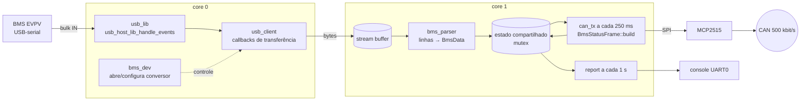

# esp32s3-usb-host-bms-reader

Leitor de BMS EVPV V2.0 por **USB Host** no ESP32-S3, com retransmissão de um
resumo do pack em **CAN** (frame `0x300`, 500 kbit/s, via MCP2515).

O micro USB do BMS é um conversor USB-serial. O ESP32-S3 faz o papel de host
na porta USB nativa (OTG), abre o conversor (CDC-ACM, CH340/CH341, CP210x ou
FTDI) a 250000 baud, decodifica as linhas CSV do BMS e, a cada 250 ms, envia
tensão do pack, corrente, delta de células e um bit de alerta no barramento
CAN. A cada 1 s um relatório sai no console da porta UART.

Firmware em ESP-IDF v5.5.1 (C++17), portado de uma versão Arduino de bancada.
O driver do MCP2515 é próprio, escrito a partir do datasheet da Microchip.

## Hardware

- **Placa:** ESP32-S3-DevKitC-1
- **BMS:** micro USB do BMS → porta **"USB"** (OTG, GPIO19/20) do DevKitC-1
- **Console:** porta **"UART"** do DevKitC-1 (UART0, 115200)
- **CAN:** módulo MCP2515 + transceiver, par trançado, 120 Ω em cada ponta do barramento

| Sinal MCP2515 | GPIO ESP32-S3 | Observação |
|---|---|---|
| SCK  | 12 | SPI2 (FSPI) |
| MISO | 13 | level shifter se o módulo for 5 V |
| MOSI | 11 | |
| CS   | 10 | |
| INT  | -  | não usado (polling) |

Pinos da fiação da bancada; cristal em [`config.h`](firmware/main/config.h) (`MCP2515_OSC_HZ`, 8 ou 16 MHz).

## Arquitetura



| Arquivo | Papel |
|---|---|
| `main/main.cpp` | `app_main`, tarefas parser / CAN TX / relatório, estado compartilhado |
| `main/bms_usb_host.*` | USB Host, detecção e configuração do conversor, stream buffer |
| `main/BmsEvpvParser.*` | parser da linha EVPV (puro, testado no host) |
| `main/BmsStatusFrame.*` | montagem do frame `0x300` (puro, testado no host) |
| `main/drivers/Mcp2515.*` | driver SPI mínimo do MCP2515 |
| `main/drivers/Mcp2515Timing.h` | cálculo de CNF1..3 para 500 kbit/s (puro, testado no host) |
| `main/report.*` | relatório no console |

## Frame 0x300 (BMS_Status_1)

ID `0x300` standard (11 bits), DLC 8, Little-Endian (Intel), enviado a cada
250 ms só se houver pacote válido do BMS nos últimos 3 s e o MCP2515 estiver
online em modo normal.

| Sinal | Byte | Bit ini/tam | Tipo | Escala | Faixa |
|---|---|---|---|---|---|
| `BMS_uPack` | 0..1 | 0 / 16 | uint16 | 0.01 V | 0 .. 655.35 V |
| `BMS_iPack` | 2..3 | 16 / 16 | int16 | 0.1 A | -3276.8 .. 3276.7 A |
| `BMS_uCellDelta` | 4..5 | 32 / 16 | uint16 | 1 mV | 0 .. 65535 mV |
| `BMS_stAlert` | 6 | 48 / 1 | bit | - | 0 / 1 |
| (reservado) | 6..7 | 49 / 15 | - | - | sempre 0 |

```
BO_ 768 BMS_Status_1: 8 Vector__XXX
 SG_ BMS_uPack : 0|16@1+ (0.01,0) [0|655.35] "V" Vector__XXX
 SG_ BMS_iPack : 16|16@1- (0.1,0) [-3276.8|3276.7] "A" Vector__XXX
 SG_ BMS_uCellDelta : 32|16@1+ (1,0) [0|65535] "mV" Vector__XXX
 SG_ BMS_stAlert : 48|1@1+ (1,0) [0|1] "" Vector__XXX
```

Valores fora da faixa saturam no limite do tipo. A corrente é arredondada para
longe do zero. `BMS_stAlert` vale 1 quando o pack está abaixo de 44,0 V ou o
delta é maior ou igual a 1000 mV.

Exemplo (pack 52,968 V, 12,45 A, delta 11 mV):

```
ID 0x300  DLC 8  B1 14 7D 00 0B 00 00 00
  bytes 0..1  BMS_uPack      = 0x14B1 = 5297 × 0.01 V = 52.97 V
  bytes 2..3  BMS_iPack      = 0x007D =  125 × 0.1 A  = 12.5 A
  bytes 4..5  BMS_uCellDelta = 0x000B =   11 mV
  byte  6     BMS_stAlert    = 0
```

### Bit timing do MCP2515 (500 kbit/s)

TQ = 2·(BRP+1)/Fosc; bit = SyncSeg 1 + PropSeg 2 + PS1 3 + PS2 2 = 8 TQ de
250 ns, amostragem em 75 %, SJW 1.

| Cristal | BRP | CNF1 | CNF2 | CNF3 |
|---|---|---|---|---|
| 8 MHz  | 0 | `0x00` | `0x91` | `0x01` |
| 16 MHz | 1 | `0x01` | `0x91` | `0x01` |

## Build e gravação

Com o ESP-IDF v5.5.1 instalado e exportado:

```
cd firmware && idf.py set-target esp32s3 && idf.py build flash monitor
```

Gravação e monitor pela porta **"UART"** do DevKitC-1. O BMS vai na porta
**"USB"** (OTG): o `sdkconfig.defaults` deixa o console só na UART0 para a
porta USB nativa ficar livre para o USB Host.

## Testes de host

Parser, frame `0x300` e valores de CNF rodam no PC, sem ESP-IDF:

```
cmake -S firmware/test/host -B build-host && cmake --build build-host && ctest --test-dir build-host -C Debug --output-on-failure
```

O CI (`.github/workflows/ci.yml`) compila o firmware e roda esses testes.

## Saída esperada

Relatório (a cada 1 s; as mensagens de partida saem com tags `USB:`/`CAN:`/`BMS:`):

```
================ BMS EVPV ================
C1   3312 mV   C2   3308 mV   C3   3315 mV   C4   3310 mV
...
Pack: 52.968 V | Min: C13 3305 mV | Max: C14 3316 mV | Delta: 11 mV
Corrente: 12.450 A | Potência: 659.5 W
Descarga: PERMITIDA | Recarga: PERMITIDA | Balanceando: NAO
Temp (C): T1=27 T2=28 T3=27 T4=29 T5=26 T6=27 T7=28 T8=27
Pacotes OK: 478 | Invalidos: 0
================ CAN TX 0x300 (MCP2515) ================
Modo: normal | enviados=476 | buffers ocupados=0 | erros SPI=0
REC=0 TEC=0 EFLG=0x00
Tarefa CAN: periodo max 250040 us (nominal 250000 us) | 4 ciclos na janela
```

Janela saudável: `Pacotes OK` e `enviados` sobem ~4/s, `Invalidos` parado (um
na partida é normal), `REC`/`TEC` baixos, `periodo max` perto de 250000 us.

## Catálogo de falhas

### Partida (USB / BMS)

| Mensagem | Significado | O que verificar |
|---|---|---|
| `BMS: Falha ao instalar o USB Host; leitura do BMS desativada.` | O driver USB Host não subiu | Target `esp32s3` e console fora do USB nativo (`sdkconfig.defaults`) |
| `USB: Conectado ... conversor: nenhum` + `Conversor USB-serial não suportado` | O chip não é CDC-ACM, CH34x, CP210x nem FTDI | VID/PID impressos; é preciso adicionar suporte |
| `USB: Nenhum endpoint bulk IN encontrado` | O dispositivo não parece um conversor serial | Cabo só de carga, ou dispositivo errado |
| `USB: Falha ao reivindicar a interface` | Interface encontrada, mas não aberta | Reconectar o cabo e reiniciar |
| `USB: Falha ao configurar a serial` | O conversor recusou baud rate/configuração | Se persistir, o conversor não aceita 250000 baud |
| `USB: Aviso: SET_LINE_CODING recusado` / `SET_CONTROL_LINE_STATE recusado` | Aviso; alguns CDC ignoram esses comandos | Nada, se `Pacotes OK` sobe |
| `USB: Falha ao iniciar a leitura` | Não foi possível alocar/enviar as transferências | Reiniciar a placa |
| `USB: Dispositivo desconectado` | O cabo saiu, ou uma falha acima fechou o dispositivo | Cabo e conector micro USB do BMS |

### Partida (CAN / MCP2515)

| Mensagem | Significado | O que verificar |
|---|---|---|
| `CAN: Falha ao iniciar o SPI do MCP2515` | `spi_bus_initialize`/`spi_bus_add_device` falhou; a tarefa CAN termina | Pinos em `config.h` |
| `CAN: Falha ao iniciar o MCP2515 (tentativa N); nova tentativa em 2000 ms` | Reset, CNF lido de volta ou troca de modo falharam | Fiação SPI, alimentação, level shifter, `MCP2515_OSC_HZ` |
| `CAN: MCP2515 fora do modo esperado; reiniciando` | O CANSTAT não mostra mais o modo pedido | Módulo perdeu alimentação ou SPI intermitente |

### Relatório: BMS

| Saída | Significado | O que verificar |
|---|---|---|
| `Conversor USB do BMS não conectado.` | Nenhum conversor aberto | Cabo e mensagens `USB:` da partida |
| `Sem pacotes válidos (inválidos: N). Verifique o baud rate/cabo.` | O USB lê, mas nenhuma linha passou no parser em 3 s | `BMS_BAUD`; ligar `BMS_PRINT_RAW_LINES` em `config.h` |
| `Invalidos` subindo junto com `Pacotes OK` | Parte das linhas chega corrompida | Cabo, ruído, aterramento, formato de linha diferente |
| `Descarga`/`Recarga: BLOQUEADA` | Proteção do próprio BMS | Células, delta e temperaturas |
| `Delta` ≥ 1000 mV ou `Pack` < 44 V | Liga `BMS_stAlert = 1` no `0x300` | Estado da bateria |

### Relatório: CAN TX / barramento

| Saída | Significado | O que verificar |
|---|---|---|
| `MCP2515 offline (falhas de init: N)` | O MCP2515 não iniciou; nova tentativa a cada 2 s | Igual à falha de partida |
| `enviados` parado com BMS OK | Frame não sai | `LISTEN_ONLY_MODE`, `buffers ocupados` |
| `buffers ocupados` subindo | Os 3 TXB esperam ACK | Nenhum outro nó no barramento, ou bitrate/cristal errado |
| `TEC=128` + `ERROR-PASSIVE` | O `0x300` é transmitido, mas ninguém dá ACK | Pela norma CAN o TEC para em 128 sem ACK e não chega a BUS-OFF |
| `REC` alto + `ERROR-PASSIVE` | Muitos erros de recepção | Terminação, par trançado, GND comum, `MCP2515_OSC_HZ` |
| `BUS-OFF` | Erros de transmissão demais; o MCP2515 parou de transmitir | Curto ou inversão CANH/CANL, bitrate ou cristal errado |
| `erros SPI` subindo | Falha de transação SPI | Integridade do SPI; reduzir `MCP2515_SPI_CLOCK_HZ` |

`REC`, `TEC` e `EFLG` são lidos a cada ciclo da tarefa CAN (250 ms). Os bits
de overflow de RX do `EFLG` são ignorados: a recepção não é usada e os buffers
de RX ficam sempre cheios, o que não afeta o ACK nem a transmissão.

### Relatório: latência

| Saída | Significado | O que verificar |
|---|---|---|
| `periodo max` bem acima de 250000 us | A tarefa CAN atrasou (prioridade, SPI lento, mutex) | Tarefas novas com prioridade maior no core 1 |
| `ciclos na janela` diferente de 4 | A tarefa CAN não está rodando no período | O mesmo |

## Validação

O caminho USB/BMS (detecção do conversor, leitura bulk, parser) e o frame
`0x300` foram validados em bancada na **versão Arduino**. Este port para
ESP-IDF e o **driver próprio do MCP2515** (bit timing, troca de modo, TX,
leitura de erros) **ainda precisam de validação em bancada**. O bit timing foi
calculado do datasheet (amostragem em 75%) e não é o mesmo da biblioteca usada
na versão Arduino, então convém confirmar com outro nó a 500 kbit/s. Os exemplos de
saída acima mostram o formato esperado. Os testes de host cobrem parser,
frame e cálculo de CNF.

## Licença

MIT, ver [LICENSE](LICENSE).
